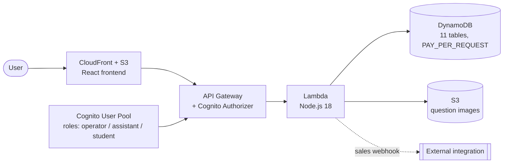

# Cloud Exam Platform

Serverless web platform for practicing cloud certification exams (AWS, Azure, GCP). Students practice against question banks that mirror the official exam format, including single choice, multiple choice, dropdown, true/false, and ordering questions.

> This repository is a sanitized showcase of a production project. Secrets, real infrastructure identifiers, and proprietary exam content have been removed or replaced with placeholders. It is meant to demonstrate architecture and code quality, not to be deployed as-is.

---

## Supported certifications

The platform is provider-agnostic and supports multiple certification tracks across AWS, Azure, and GCP (e.g. Cloud Practitioner, Developer Associate, Solutions Architect, Azure Fundamentals/Administrator, GCP Cloud Digital Leader). Question banks themselves are not part of this repository.

## Architecture



## Tech stack

| Layer | Technology |
|-------|-----------|
| Frontend | React 18, TypeScript, Vite, React Router |
| Backend | Node.js 18, TypeScript, AWS Lambda, SAM |
| Database | Amazon DynamoDB (11 tables, PAY_PER_REQUEST) |
| Auth | Amazon Cognito (User Pool + Groups) |
| Storage | Amazon S3 (question images) |
| CDN | Amazon CloudFront |
| Infrastructure | AWS SAM (CloudFormation) |

## Project structure

```
├── frontend/                  # React application
│   ├── src/
│   │   ├── components/        # React components
│   │   ├── contexts/          # AuthContext, LanguageContext
│   │   ├── pages/             # Role-based dashboards
│   │   ├── services/          # API calls
│   │   └── types/             # TypeScript types
│   └── package.json
│
├── backend/                   # Lambda functions
│   ├── src/
│   │   ├── handlers/          # API Gateway handlers
│   │   ├── services/          # Business logic
│   │   ├── models/            # Data models
│   │   ├── middleware/        # Auth middleware
│   │   └── config/            # Configuration and DB
│   ├── template.yaml          # SAM template (infrastructure)
│   └── package.json
│
├── .gitignore
└── README.md
```

## Roles and permissions

### Operator
- Student management (create, enable/disable, delete)
- Assistant management
- Course management (create, edit, delete)
- Enrollment management
- Site availability control

### Assistant
- Question management (create, edit, delete, CSV import/export)
- Student management (create, activate, reset password, enroll)
- Course management (create, edit)
- Image upload for questions

### Student
- View enrolled courses with certification badge
- Take exams with a configurable timer
- View results with per-alternative explanations
- Attempt history
- Post-exam review mode with explanations
- Trial access (limited questions, limited attempts, limited days)

## Question types

| Type | Description |
|------|-------------|
| `single` | Single choice — one correct alternative |
| `multiple` | Multiple choice — two or more correct alternatives |
| `dropdown` | Each statement has a dropdown of options |
| `truefalse` | Each statement is marked true/false (Yes/No) |
| `ordering` | Arrange items in the correct sequence (drag & drop) |

Each question includes:
- `explanation`: why the correct answer is correct
- `incorrectExplanation`: why each incorrect alternative is incorrect
- Image support in both the question and its alternatives

## Exam configuration

Each course has independent configuration:

| Field | Description | Example |
|-------|-------------|---------|
| `examQuestionCount` | Questions per exam (random selection from the bank) | 65 |
| `timeLimitMinutes` | Time limit in minutes (0 = no limit) | 130 |
| `passingPercentage` | Minimum passing percentage | 72 |
| `unscoredQuestions` | Unscored (pretest) questions, like the official exam | 15 |
| `reviewModeEnabled` | Allow reviewing answers with explanations after the exam | true |
| `badgeImageUrl` | Certification badge image URL | S3 URL |

## Data model (DynamoDB)

| Table | Primary key | GSIs | Description |
|-------|-------------|------|-------------|
| questions | id | courseCode-createdAt | Questions with explanations |
| alternatives | id | questionId-order | Alternatives per question |
| courses | code | provider | Course configuration |
| enrollments | id | studentId-courseCode | Student enrollments |
| exam-sessions | id | studentId-startTime, isActive | Active exam sessions |
| answers | id | sessionId-questionId | Student answers |
| exam-results | id | studentId-completedAt, sessionId | Historical results |
| system-config | key | — | System configuration |
| users | id | email | Legacy (auth handled by Cognito) |
| students | userId | email | Legacy (data in Cognito) |
| question-history | id | questionId-version | Version history |

## Notable features

- **Unscored (pretest) questions:** As in the official exam, N questions are randomly flagged as unscored. The student does not know which ones.
- **Random selection:** Each exam picks random questions from the bank, different on every attempt.
- **Session-pinned question IDs:** Assigned questions are stored in the session to score correctly.
- **Automatic token refresh:** The Cognito token refreshes automatically a few minutes before expiry, avoiding session loss during long exams.
- **Trial → full upgrade:** If a student has a trial enrollment and is assigned a full one, the trial is replaced automatically.
- **Sales webhook:** Public endpoint (API-key authenticated) for integration with external automations that create users and enrollments.
- **Bilingual UI:** English and Spanish.

## Prerequisites

- Node.js 18+
- AWS CLI v2 configured
- AWS SAM CLI
- An AWS account with permissions for: Lambda, API Gateway, DynamoDB, S3, CloudFront, Cognito, CloudFormation, IAM

## Local setup

```bash
git clone <repository-url>
cd cloud-exam-platform

# Backend dependencies
cd backend
npm install

# Frontend dependencies
cd ../frontend
npm install
```

## Environment variables

Copy the example files and fill in your own values. Never commit real secrets or identifiers.

### Backend (`backend/.env.example`)

| Variable | Description |
|----------|-------------|
| `COGNITO_USER_POOL_ID` | Cognito User Pool ID |
| `COGNITO_CLIENT_ID` | Cognito App Client ID |
| `DYNAMODB_TABLE_PREFIX` | DynamoDB table prefix |
| `S3_BUCKET_NAME` | S3 bucket for images |
| `WEBHOOK_API_KEY` | API key for the sales webhook |

### Frontend (`frontend/.env.example`)

| Variable | Description |
|----------|-------------|
| `VITE_API_BASE_URL` | API Gateway URL |
| `VITE_COGNITO_USER_POOL_ID` | Cognito User Pool ID |
| `VITE_COGNITO_CLIENT_ID` | Cognito App Client ID |

## Deploy

### Backend

```bash
cd backend
npm run build          # Compile TypeScript
sam build              # SAM build
sam deploy             # Deploy to AWS (uses samconfig.toml)
```

### Frontend

```bash
cd frontend
npm run build          # Build + deploy via your pipeline
```

### Environments

| Environment | Stack name | Table prefix |
|-------------|-----------|--------------|
| Development | cloud-exam-platform | cloud-exam-platform-development |
| Staging | cloud-exam-platform-staging | cloud-exam-platform-staging |
| Production | cloud-exam-platform-prod | cloud-exam-platform-prod |

## Main API endpoints

### Auth
- `POST /auth/login` — Cognito login
- `POST /auth/logout` — Logout
- `GET /auth/me` — Current user

### Student
- `GET /courses` — Enrolled courses
- `POST /exams/start` — Start an exam
- `POST /exams/{sessionId}/answers` — Submit an answer
- `POST /exams/{sessionId}/complete` — Complete an exam
- `GET /exams/history` — Exam history
- `POST /exams/abandon` — Abandon an exam

### Assistant
- `GET/POST /assistant/students` — Student CRUD
- `POST /assistant/enrollments` — Create enrollment
- `GET/POST /assistant/courses` — Course CRUD
- `GET/POST/PUT/DELETE /questions` — Question CRUD
- `POST /questions/bulk-import` — Bulk import questions (CSV)

### Operator
- `GET/POST/PUT/DELETE /students` — Student CRUD
- `GET/POST/PUT/DELETE /operator/courses` — Course CRUD
- `GET/POST/PUT/DELETE /operator/assistants` — Assistant CRUD
- `PUT /system/availability` — Site availability

### Trial (public, no auth)
- `GET /trial/courses` — Courses available for trial
- `POST /trial/register` — Trial registration

### Webhook (public, API-key auth)
- `POST` (Function URL) — Sales webhook

## Security

- Authentication via AWS Cognito (ID tokens validated by API Gateway)
- Role-based authorization (Cognito Groups: operators, assistants, students)
- JWT tokens with automatic refresh
- API Gateway with a Cognito Authorizer
- Least-privilege IAM permissions per Lambda function
- Image S3 bucket with public read access

## License

MIT — sample/portfolio project.
